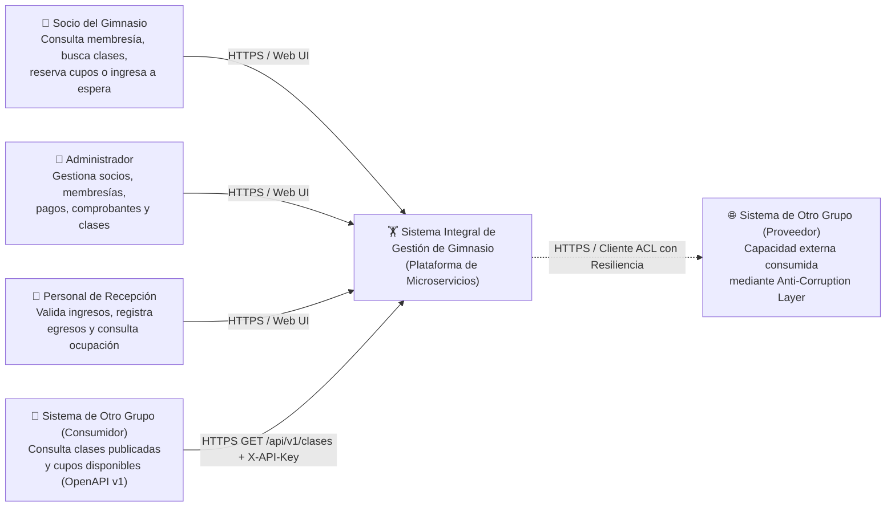

# Arquitectura del Sistema - Entrega 2: Dominio propio de punta a punta

Este documento describe la arquitectura técnica, las responsabilidades de los servicios, el flujo principal y las decisiones de diseño validadas para la **Entrega 2**.

## Microservicios y responsabilidades

| Servicio | Responsabilidades | Estado en Entrega 2 |
|---|---|---|
| **Socios y Membresías** | Administrar socios, planes y membresías; registrar pagos y comprobantes; verificar vigencia y habilitación de membresías para fechas solicitadas; emitir eventos de cambio de estado. | **Operativo con PostgreSQL.** Expone validación síncrona en `/api/v1/socios/:socioId/habilitacion` con trazabilidad distribuida W3C. |
| **Clases y Reservas** | Publicar clases y horarios; gestionar reservas y cancelaciones; controlar capacidad y listas de espera; publicar la **capacidad compartida** para otros grupos (`GET /api/v1/clases`). | **Operativo con PostgreSQL.** Implementa flujo de reserva concurrente con bloqueo pesimista, promoción automática y contrato OpenAPI v1.0.0 sobre datos reales. |
| **Accesos y Ocupación** | Administrar sedes; registrar ingresos y egresos; validar membresía antes del ingreso; calcular ocupación a partir de presencias abiertas; gestionar caché de ocupación. | Estructura HTTP lista; soporte de MongoDB 8.0 replica set configurado. |
| **API Gateway (NGINX)** | Enrutar peticiones entrantes, aplicar balanceo de carga (`least_conn`), propagar cabeceras de traza (`traceparent`, `X-Correlation-ID`) y desacoplar la red interna. | Operativo en puerto `8080` (o `GATEWAY_PORT`). |

## Propiedad de los datos y persistencia (D1, D3)

Cada servicio posee almacenamiento propio e independiente. Ningún servicio accede directamente a las tablas de otro:

- **`Socios y Membresías` (PostgreSQL 17):** tablas `socios` y `membresias`.
- **`Clases y Reservas` (PostgreSQL 17):** tablas `clases`, `reservas` y `lista_espera`. Restricciones de unicidad parcial (`uq_reserva_activa`) para impedir duplicados y bloqueos de fila (`FOR UPDATE`) para proteger el aforo del último cupo.
- **`Accesos y Ocupación` (MongoDB 8.0 replica set):** colecciones de sedes, movimientos e historial de asistencia.

## Flujo principal implementado de punta a punta

1. **Consulta de clases y cupos (Capacidad Compartida):**
   - El socio o consumidor externo consulta `GET /api/v1/clases` o `GET /api/v1/clases/:claseId` a través del Gateway.
   - `Clases y Reservas` calcula dinámicamente en PostgreSQL `cuposDisponibles = capacidad - COUNT(reservas activas)`.
   - Responde con `Cache-Control: no-store` y cabeceras de traza W3C.
2. **Solicitud de reserva:**
   - El cliente envía `POST /api/v1/reservas` con `{ claseId, socioId }`.
   - `Clases y Reservas` verifica sincrónicamente la membresía llamando a `GET /api/v1/socios/:socioId/habilitacion?fecha=<inicioClase>` en `Socios y Membresías`, reenviando `traceparent` y `X-Correlation-ID`.
   - Si la membresía está inactiva o vencida, retorna `422 MEMBRESIA_NO_HABILITADA`.
3. **Confirmación transaccional:**
   - Bajo una transacción PostgreSQL con `FOR UPDATE`, se verifica que el socio no tenga una reserva confirmada previa y que existan cupos libres.
   - Si hay cupo, se inserta la reserva con estado `CONFIRMADA` (HTTP 201).
   - Si la clase está llena, se ofrece ingreso voluntario a la lista de espera (HTTP 409 con opción de espera).
4. **Cancelación y promoción automática:**
   - Si un socio cancela su reserva (`POST /api/v1/reservas/:id/cancelar`), el cupo liberado inspecciona la `lista_espera`, revalida la membresía del siguiente candidato en orden de inscripción y lo promueve automáticamente a reserva `CONFIRMADA`.

## Trazabilidad distribuida y logs estructurados (D11)

- **Logs estructurados:** Todos los servicios emiten logs en formato JSON estándar (Pino) con campos: `time`, `level`, `service`, `trace_id`, `span_id`, `parent_span_id`, `msg`.
- **Correlación distribuida:** Cada petición que atraviesa el flujo principal comparte el mismo `trace_id` de 32 caracteres hexadecimales, evidenciado en el script `node scripts/demostrar-traza-distribuida.mjs`.

## Diagrama de contexto (C4 - Nivel 1)



## Diagrama de contenedores (C4 - Nivel 2)

```mermaid
flowchart TB
    actores["Socio · Administrador · Recepción<br/>(Navegador Web / SPA React)"] --> gateway
    consumidor["Microservicio de otro grupo consumidor"] -->|X-API-Key: consulta clases y cupos| gateway
    
    subgraph backend["Backend Distribuido del Gimnasio"]
        gateway["API Gateway & Frontend (NGINX 1.28)<br/>Balanceo least_conn · Trazas W3C · SPA Estática"]
        
        gateway -->|POST /api/v1/reservas<br/>GET /api/v1/clases| clases["Clases y Reservas (2 réplicas)<br/>Fastify + TypeScript · Hexagonal"]
        gateway -->|GET /api/v1/socios/:id<br/>POST /api/v1/auth/*| socios["Socios y Membresías<br/>Fastify + TypeScript · Capas"]
        gateway -->|Sedes, accesos y ocupación| accesos["Accesos y Ocupación<br/>Fastify + TypeScript · Eventos"]
        
        clases -->|HTTP Síncrono: GET /habilitacion<br/>Timeout 3s + Retries + Traceparent| socios
        clases --> dbClases[("Base de Datos Clases<br/>PostgreSQL 17<br/>clases, reservas, lista_espera")]
        socios --> dbSocios[("Base de Datos Socios<br/>PostgreSQL 17<br/>socios, membresias")]
        accesos --> dbAccesos[("Base de Datos Accesos<br/>MongoDB 8.0 replica set")]
        
        socios -.->|Evento MembresiaActualizada (Outbox)| rabbitmq["RabbitMQ 4.1"]
        rabbitmq -.->|Consumo asíncrono| clases
    end
```

## Diagrama de secuencia del flujo principal (Entrega 2)

```mermaid
sequenceDiagram
    autonumber
    actor Socio
    participant GW as API Gateway (NGINX)
    participant CR as Clases y Reservas
    participant SM as Socios y Membresías
    participant DB_SM as PostgreSQL (socios)
    participant DB_CR as PostgreSQL (clases)

    Socio->>GW: POST /api/v1/reservas { claseId, socioId }
    GW->>CR: Proxy + traceparent (00-traceId-spanId-01)
    CR->>DB_CR: SELECT clase (verificar existencia y que no haya iniciado)
    CR->>SM: GET /api/v1/socios/:socioId/habilitacion?fecha=inicio (Child Span)
    SM->>DB_SM: SELECT socio + membresía activa
    DB_SM-->>SM: Estado y vigencia
    SM-->>CR: 200 OK { habilitado: true, membresia }
    CR->>DB_CR: BEGIN; SELECT ... FROM clases FOR UPDATE
    CR->>DB_CR: Verificar duplicado (uq_reserva_activa) y contar cupos ocupados
    alt Hay cupo disponible
        CR->>DB_CR: INSERT INTO reservas (CONFIRMADA); COMMIT
        CR-->>GW: 201 Created (Reserva confirmada + traceparent)
        GW-->>Socio: 201 Created
    else Clase sin cupos
        CR->>DB_CR: ROLLBACK
        CR-->>GW: 409 Conflict { codigo: CLASE_SIN_CUPOS, puedeIngresarEspera: true }
        GW-->>Socio: 409 Conflict (Ofrece lista de espera)
    end
```

## Registro de Decisiones Arquitectónicas (ADR)

| Decisión | Título | Estado | Documento |
|---|---|---|---|
| **D1** | Límites de servicios y propiedad de los datos | Validada en E2 | [ADR-001](adr/ADR-001-limites-de-servicios.md) |
| **D2** | Arquitectura interna de los servicios | Decidida en E2 | [ADR-002](adr/ADR-002-arquitectura-interna-de-servicios.md) |
| **D3** | Persistencia relacional y documental | Validada en E2 con PostgreSQL | [ADR-003](adr/ADR-003-persistencia.md) |
| **D4** | Consistencia y concurrencia | Decidida en E2 | [ADR-004](adr/ADR-004-consistencia-y-concurrencia.md) |
| **D5** | Comunicación entre servicios (Síncrona y Asíncrona) | Validada en E2 | [ADR-005](adr/ADR-005-comunicacion-entre-servicios.md) |
| **D6** | Búsqueda | Decidida en E2 | [ADR-006](adr/ADR-006-busqueda.md) |
| **D7** | Caché | Decidida en E2 | [ADR-007](adr/ADR-007-cache.md) |
| **D8** | Contrato de la capacidad propia | Actualizada en E2 (PostgreSQL real) | [ADR-008](adr/ADR-008-contrato-propio.md) |
| **D9** | Consumo del proveedor externo | Decidida en E2 | [ADR-009](adr/ADR-009-consumo-del-proveedor.md) |
| **D10** | Resiliencia | Decidida en E2 | [ADR-010](adr/ADR-010-resiliencia.md) |
| **D11** | Observabilidad (Logs, Trazas y Métricas) | 1ª versión en E2 | [ADR-011](adr/ADR-011-observabilidad.md) |
| **D12** | Balanceo de carga | Decidida en E2 | [ADR-012](adr/ADR-012-balanceo-de-carga.md) |
| **D13** | Capacidad y estimación de costos | Decidida en E2 | [ADR-013](adr/ADR-013-capacidad-y-costos.md) |
