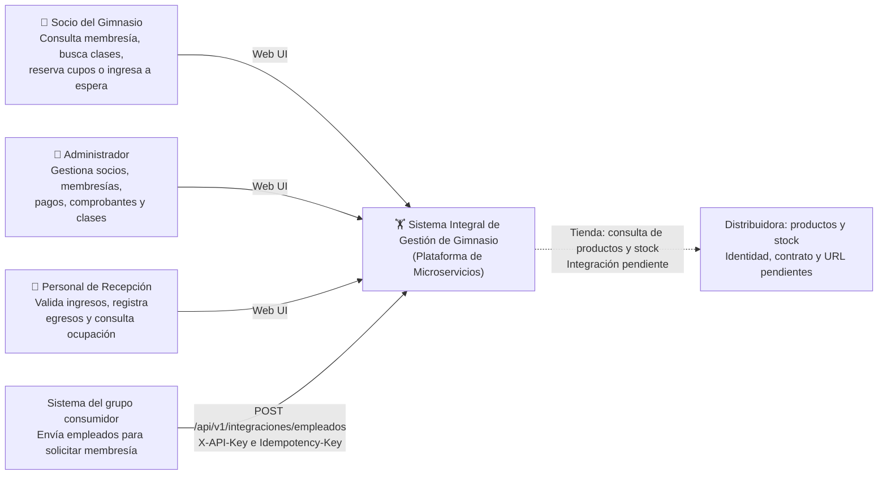
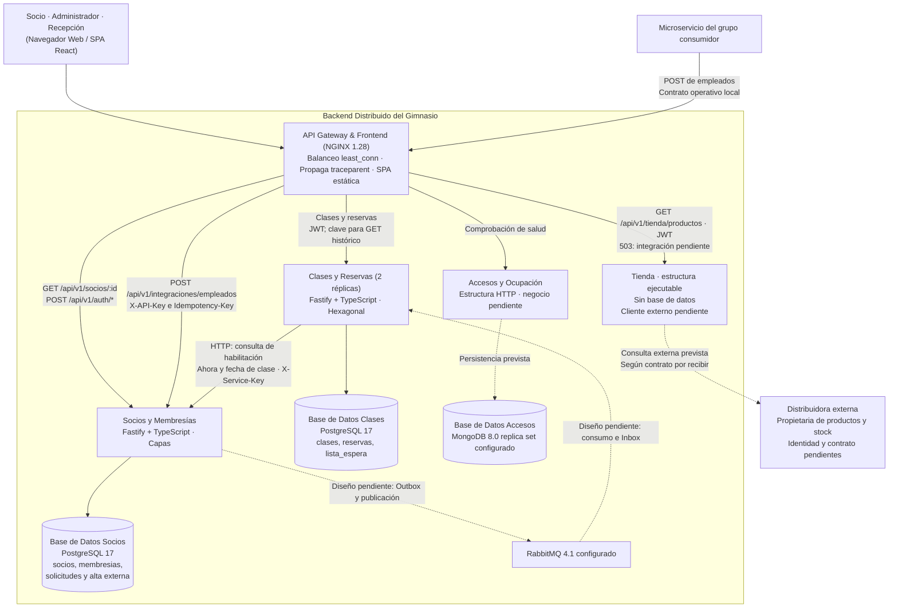

# Arquitectura del sistema

**Estado documental:** 20/10/2026. Evolución del diseño de E1 con el flujo propio y la capacidad de empleados operativos localmente. Se distinguen responsabilidades del sistema previsto e implementación disponible.

**Enunciado:** §3, página 4; §4.1, páginas 5–6; §5, páginas 6–7; §6.2–6.3, página 8. Los patrones internos y el balanceo corresponden a §2.1 y §2.3, página 2.

## Servicios, responsabilidades y datos

| Servicio | Responsabilidad y propiedad | Implementación actual |
|---|---|---|
| **Socios y Membresías** | Socios, planes, membresías, pagos, comprobantes, referencia de empleados externos y solicitudes. | Capas; JWT, altas administrativas, habilitación y POST externo. PostgreSQL: `socios`, `membresias`, `solicitudes_membresia`, `empleados_externos`, `altas_empleados_idempotencia`. Pagos, planes y resolución administrativa pendientes. |
| **Clases y Reservas** | Clases, capacidad, reservas, espera e índice de búsqueda derivado. | Hexagonal; catálogo, reservas/cancelación y recuperación FIFO. PostgreSQL: `clases`, `reservas`, `lista_espera`. Publicación administrativa y consulta textual pendientes. |
| **Accesos y Ocupación** | Sedes, intentos y movimientos de acceso, presencias y ocupación/caché derivadas. | Estructura HTTP. MongoDB configurado; persistencia y reglas de negocio pendientes. |
| **Tienda** | Integrar la consulta de productos y stock. El catálogo y las existencias pertenecen a la distribuidora. | Estructura en Capas, JWT y pantalla. Sin base propia ni cliente externo; devuelve `503 INTEGRACION_PENDIENTE`. |

Socios y Clases usan bases y usuarios PostgreSQL separados en una instancia local compartida; no hay acceso de un servicio a tablas ajenas. MongoDB tiene un replica set de un solo nodo, sin redundancia. El diseño de motores y restricciones se justifica en [D3](adr/ADR-003-persistencia.md); los límites vigentes, en [D1](adr/ADR-015-limites-con-tienda.md).

NGINX sirve el portal React y enruta las solicitudes por un único puerto local (`8080` o `GATEWAY_PORT`). La autenticación y los permisos se validan en los servicios. Las llamadas internas y la futura salida al proveedor no pasan por nuestro gateway.

## Arquitectura interna e identidad

- **Clases, Hexagonal:** `app.ts` adapta HTTP; `application/reservas.service.ts` contiene casos de uso; `ports.ts` declara las interfaces; PostgreSQL, memoria y cliente HTTP de Socios son adaptadores. `server.ts` compone y arranca el trabajador de promociones.
- **Socios, Capas:** HTTP (`app.ts`, `empleados.http.ts`) → servicios de aplicación (`services.ts`, `empleados.service.ts`) → repositorio. La criptografía y la configuración de JWT están en `security.ts`.
- **Tienda, Capas:** HTTP/autenticación → servicio de consulta pendiente; todavía no tiene adaptador externo. Accesos conserva su diseño por eventos/proyección, sin implementarlo.
- **Identidad:** JWT HS256 firmado con vencimiento configurable (una hora por defecto), rol y controles de propietario. Alta interna solo ADMIN; bootstrap local sin contraseña administrativa predeterminada nueva. El portal mantiene la sesión en memoria. [D2](adr/ADR-002-arquitectura-interna-de-servicios.md), [autenticación](adr/ADR-016-autenticacion-y-altas.md).

## Comunicaciones y operaciones consistentes

### Flujo principal: reservar una clase

1. El portal obtiene catálogo, reservas y espera propias con `GET /api/v1/reservas/clases` y Bearer JWT. Las consultas históricas `/api/v1/clases` conservan `X-API-Key` y el contrato anterior.
2. Antes del inicio, `POST /api/v1/reservas` recibe `claseId` y, si se eligió, `ingresarEsperaSiLlena`. La identidad se toma del token; solo ADMIN puede indicar otro socio.
3. Clases consulta en paralelo a Socios para ahora y para la fecha de clase, con `X-Service-Key`. Cada verificación tiene presupuesto de 3000 ms, incluido cuerpo y como máximo un reintento. Una respuesta desconocida produce indisponibilidad, no habilitación.
4. La escritura bloquea primero la fila de la clase, vuelve a verificar inicio, duplicados, cupo y prioridad de espera y confirma la reserva o la espera voluntaria. Los índices únicos parciales respaldan las restricciones.
5. Una cancelación anterior al inicio se guarda sin depender de Socios. Si hay espera, el cupo conserva esa prioridad. El trabajador valida al primero fuera del bloqueo y confirma la promoción atómicamente; si hay falla de red, conserva al candidato y reintenta. Una inhabilitación comprobada lo retira y permite evaluar al siguiente.

El trabajador recupera el trabajo de las tablas persistidas al iniciar y cada 5 s por defecto, sin superponer pasadas en una instancia. Varias instancias pueden competir; la transacción comprueba nuevamente el estado. No hay una transacción distribuida entre las bases: las validaciones remotas son puntuales. Detalle en [D4 vigente](adr/ADR-017-consistencia-y-recuperacion-de-espera.md) y [D5](adr/ADR-005-comunicacion-entre-servicios.md).

### Capacidad ofrecida: recepción de empleados

Socios expone `POST /api/v1/integraciones/empleados`, contrato **1.0.1**, como reemplazo de la capacidad de clases asignada inicialmente. `X-API-Key` identifica el origen y `Idempotency-Key` delimita la repetición. Una transacción guarda socio sin contraseña, solicitud `PENDIENTE`, referencia externa y respuesta original. El replay devuelve esa respuesta; los conflictos no sobrescriben datos. El pago y la habilitación posterior no forman parte del POST.

El [contrato y sus ejemplos](contracts/README.md) y [D8 vigente](adr/ADR-014-contrato-empleados.md) describen campos, errores y versionado. Hay un mock separado en memoria; la implementación local usa PostgreSQL. Falta publicar una URL accesible y verificarla con el consumidor.

### Capacidad consumida: Tienda

El portal llama por nuestro gateway a `GET /api/v1/tienda/productos` con JWT. Actualmente recibe `503 INTEGRACION_PENDIENTE`. La ruta es interna del gimnasio; no define la API de la distribuidora. La salud `/health/tienda` confirma solo la estructura HTTP.

Tienda será quien llame al proveedor y adapte su contrato, sin stock ni base local. Falta recibir contrato, URL y autenticación para fijar rutas, modelo de productos, errores y políticas temporales. No se inventan cantidades ni una integración exitosa. [D9](adr/ADR-009-consumo-del-proveedor.md).

### Mensajería prevista

RabbitMQ está configurado. Se conserva el diseño `MembresiaActualizada` con Outbox en Socios, consumidor idempotente/Inbox en Clases y cola de mensajes fallidos. Publicador, consumidor y recuperación aún no están implementados; la suspensión posterior no cancela automáticamente reservas futuras todavía. [D5](adr/ADR-005-comunicacion-entre-servicios.md).

## Balanceo y observabilidad

NGINX distribuye con `least_conn` entre dos instancias de Clases; usa DNS dinámico y detección pasiva de fallos. Compose comprueba salud y coordina el inicio, pero su marca `healthy` no configura una sonda activa de NGINX. `X-Instance-ID` identifica la réplica; los logs del proxy muestran upstreams, estados y tiempos. El ensayo comprobó continuidad y reemplazo sin reiniciar el gateway, con cuatro 504 transitorios durante detección. [D12](adr/ADR-012-balanceo-de-carga.md), [postmortem](POSTMORTEM.md).

Socios y Clases emiten logs de negocio JSON con `trace_id`, `span_id` y padre. Clases propaga su contexto a las dos verificaciones HTTP de Socios; los servicios devuelven identificadores de traza. `npm run test:postgres` exige correlación, relación padre/hijo y reserva persistida entre instancias HTTP con puertos distintos. La demostración con `inject` es complementaria. Los campos de correlación entrantes de NGINX pueden estar vacíos si el cliente no los envía; no se afirma cobertura de todos los logs de infraestructura.

Las métricas actuales son contadores HTTP/errores, uptime y conexiones ocupadas del pool. No hay tableros, alertas, histogramas ni backend de trazas todavía. La estrategia y objetivos propuestos están en [D11](adr/ADR-011-observabilidad.md); carga local y costos ilustrativos, en [D13](adr/ADR-013-capacidad-y-costos.md).

## Diagrama de contexto (C4 - Nivel 1)

El contexto representa el alcance del sistema. Las funciones administrativas y de recepción no implementadas se identifican en la tabla de servicios y en las limitaciones.



## Diagrama de contenedores (C4 - Nivel 2)



Las líneas discontinuas indican integraciones previstas. El entorno local utiliza HTTP; HTTPS y publicación accesible se resolverán en el despliegue.

## Diagrama de secuencia del flujo principal

```mermaid
sequenceDiagram
    autonumber
    actor Socio
    participant GW as API Gateway (NGINX)
    participant CR as Clases y Reservas
    participant SM as Socios y Membresías
    participant DB_SM as PostgreSQL (socios)
    participant DB_CR as PostgreSQL (clases)

    Socio->>GW: POST /api/v1/reservas { claseId }, Bearer JWT
    GW->>CR: Proxy + traceparent (00-traceId-spanId-01)
    CR->>CR: Verificar JWT y propietario
    CR->>DB_CR: SELECT clase (verificar existencia y que no haya iniciado)
    par Habilitación actual
        CR->>SM: GET habilitacion?fecha=ahora, X-Service-Key
    and Habilitación al inicio
        CR->>SM: GET habilitacion?fecha=inicio, X-Service-Key
    end
    SM->>DB_SM: SELECT socio + historial de membresías para cada fecha
    DB_SM-->>SM: Estado y períodos aplicables
    SM-->>CR: Ambas respuestas habilitadas (o error sin confirmar reserva)
    CR->>DB_CR: BEGIN; SELECT ... FROM clases FOR UPDATE
    CR->>DB_CR: Reverificar inicio, duplicados, aforo y prioridad de espera
    alt Hay cupo y no hay espera pendiente
        CR->>DB_CR: INSERT INTO reservas (CONFIRMADA); COMMIT
        CR-->>GW: 201 Created (Reserva confirmada + traceparent)
        GW-->>Socio: 201 Created
    else Sin cupo asignable respetando espera
        CR->>DB_CR: ROLLBACK
        CR-->>GW: 409 Conflict { codigo: CLASE_SIN_CUPOS, puedeIngresarEspera: true }
        GW-->>Socio: 409 Conflict (Ofrece lista de espera)
    end
```

## Limitaciones conocidas y deuda técnica aceptada

- **Dominio pendiente:** pagos/comprobantes, planes, renovación/reactivación, resolución de solicitudes, credenciales de empleados, publicación de clases, movimientos y ocupación de Accesos. El frontend no simula éxito de esas funciones.
- **Integración externa:** Tienda aún no consume productos/stock y carece de test de contrato del proveedor. La integración debe incorporarse a un flujo importante (§4.1); su preparación interna no acredita ese requisito. Falta URL accesible y prueba conjunta de la capacidad propia.
- **Búsqueda y caché:** FTS/GIN creado pero sin consulta textual; Redis/caché de negocio pendiente de implementación y medición comparativa.
- **Mensajería:** broker configurado sin evento publicado/consumido, Inbox/Outbox ni DLQ; reservas futuras no se cancelan automáticamente por una suspensión posterior.
- **Disponibilidad:** un gateway, una instancia PostgreSQL y MongoDB de un nodo. Dos réplicas HTTP no eliminan esos puntos de falla ni los errores durante detección. No hay despliegue multizona ni protección completa por circuit breaker/límite de concurrencia.
- **Identidad:** Clases y Tienda validan el JWT hasta su vencimiento; no hay revocación inmediata ni refresh tokens. La configuración actual del POST admite un origen externo por entorno.
- **Operación:** faltan tableros/alertas, prueba de carga sostenida y presupuesto definitivo. Las mediciones locales no acreditan SLO ni capacidad máxima. El postmortem registra un ensayo local, no la jornada completa con proveedor.
- **Datos de demostración:** clases con fechas fijas y cuentas ficticias; los datos persistidos pueden diferir de los iniciales. No hay gestión versionada completa de migraciones ni política de purga de idempotencia.

Estas limitaciones mantienen visibles los requisitos generales y de la presentación final pendientes (§6, páginas 8–9); no amplían el alcance funcional acordado.

## Decisiones arquitectónicas


| Decisión | Título | Estado | Documento |
|---|---|---|---|
| **D1 anterior** | Límites de los tres servicios originales | Reemplazado por ADR-015; conservado como antecedente | [ADR-001](adr/ADR-001-limites-de-servicios.md) |
| **D1 vigente** | Límites con Tienda como cuarto microservicio | Estructura propia preparada; consulta externa pendiente | [ADR-015](adr/ADR-015-limites-con-tienda.md) |
| **D2** | Arquitectura interna de los servicios | Hexagonal y Capas concretadas en Clases/Socios | [ADR-002](adr/ADR-002-arquitectura-interna-de-servicios.md) |
| **D3** | Persistencia relacional y documental | PostgreSQL propio y alta externa atómica verificados | [ADR-003](adr/ADR-003-persistencia.md) |
| **D4 anterior** | Consistencia y concurrencia | Reemplazada por ADR-017; antecedente | [ADR-004](adr/ADR-004-consistencia-y-concurrencia.md) |
| **D4 vigente** | Consistencia y recuperación FIFO | Cancelación local y promoción recuperable verificadas | [ADR-017](adr/ADR-017-consistencia-y-recuperacion-de-espera.md) |
| **D5** | Comunicación entre servicios (Síncrona y Asíncrona) | HTTP y POST externo operativos; mensajería pendiente | [ADR-005](adr/ADR-005-comunicacion-entre-servicios.md) |
| **D6** | Búsqueda | Catálogo filtrado; FTS preparado, consulta textual pendiente | [ADR-006](adr/ADR-006-busqueda.md) |
| **D7** | Caché | Diseño documentado; Redis pendiente | [ADR-007](adr/ADR-007-cache.md) |
| **D8** | Contrato de la capacidad propia anterior | Reemplazado para la publicación externa; antecedente de consultas de clases | [ADR-008](adr/ADR-008-contrato-propio.md) |
| **Actualización de D8** | Recepción de empleados y solicitud pendiente | Contrato 1.0.1, mock y POST persistente local verificados | [ADR-014](adr/ADR-014-contrato-empleados.md) |
| **D9** | Consumo del proveedor externo | Tienda responde integración pendiente; proveedor y contrato por recibir | [ADR-009](adr/ADR-009-consumo-del-proveedor.md) |
| **D10** | Resiliencia | Implementación parcial y pendientes identificados | [ADR-010](adr/ADR-010-resiliencia.md) |
| **D11** | Observabilidad (Logs, Trazas y Métricas) | 1ª versión en E2 | [ADR-011](adr/ADR-011-observabilidad.md) |
| **D12** | Balanceo de carga | Distribución, detección y reemplazo verificados con límites explícitos | [ADR-012](adr/ADR-012-balanceo-de-carga.md) |
| **D13** | Capacidad y estimación de costos | Línea base local y estimación ilustrativa | [ADR-013](adr/ADR-013-capacidad-y-costos.md) |
| Adicional | Autenticación y altas administradas | JWT, permisos y bootstrap local implementados | [ADR-016](adr/ADR-016-autenticacion-y-altas.md) |
