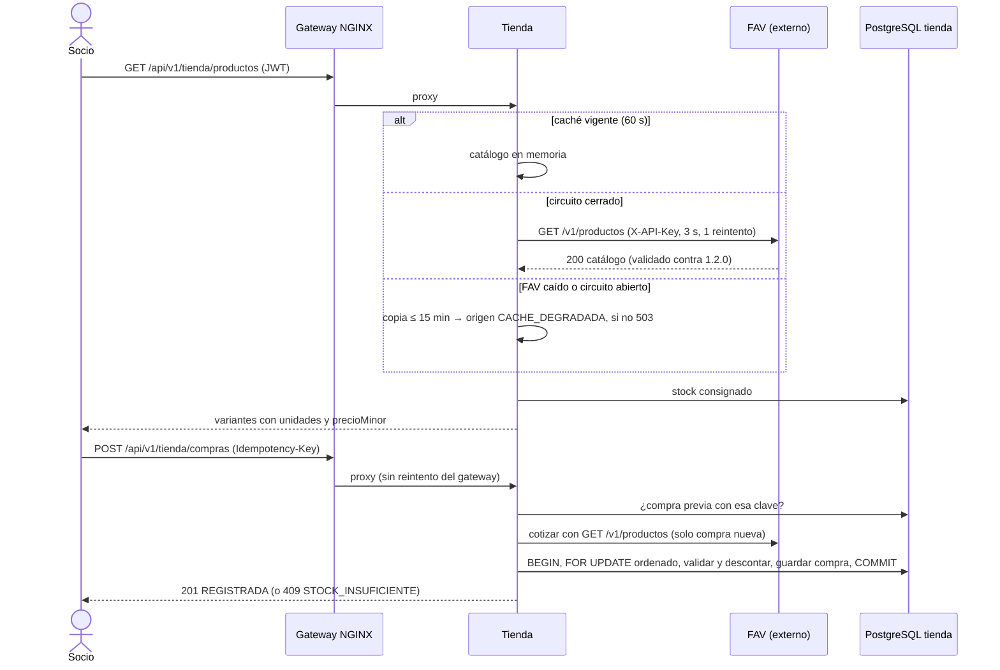
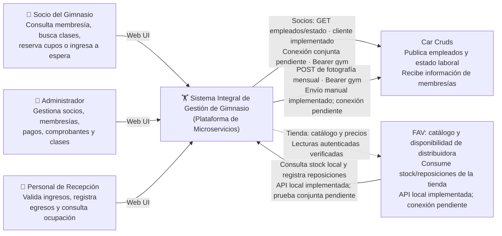
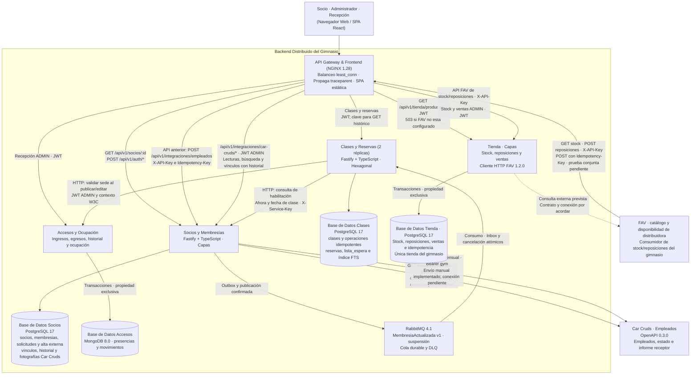

# Arquitectura del sistema

**Estado documental.** Revisión al 09/11/2026: Tienda consume el catálogo de FAV y los socios compran (ADR-023/024); el gateway valida JWT y limita tráfico (ADR-025); hay Prometheus, Grafana y alertas (D11); se agregaron test de carga (D13) y despliegue en VM preparado (ADR-026). El texto que sigue es la revisión al 08/11/2026, con búsqueda en API/portal, publicación/edición ADMIN y suspensión mediante eventos verificadas localmente. Car Cruds dispone de lecturas, vinculación y envío mensual manual con persistencia e historial; conexión operativa y prueba conjunta pendientes. Tienda implementa stock/reposiciones para FAV y ventas administrativas con PostgreSQL; publicación y prueba conjunta pendientes. El POST anterior de empleados conserva su implementación.

**Enunciado:** §3, página 4; §4.1, páginas 5–6; §5, páginas 6–7; §6.2–6.3, página 8. Los patrones internos y el balanceo corresponden a §2.1 y §2.3, página 2.

## Servicios, responsabilidades y datos

| Servicio | Responsabilidad y propiedad | Implementación actual |
|---|---|---|
| **Socios y Membresías** | Socios, planes, membresías, pagos, comprobantes, referencias externas, solicitudes, vínculos Car Cruds, auditoría y registro de fotografías/envíos. | Capas; JWT, altas, habilitación, lecturas/vinculación/envío manual Car Cruds para ADMIN y POST anterior. PostgreSQL: `socios`, `membresias`, `solicitudes_membresia`, `empleados_externos`, `altas_empleados_idempotencia`, `car_cruds_vinculos`, `car_cruds_vinculos_historial`, `car_cruds_evidencias_series` y `car_cruds_evidencias`. Planes, solicitudes y pagos manuales con comprobantes transaccionales (ADR-021); conexión externa conjunta pendiente. |
| **Clases y Reservas** | Clases, capacidad, reservas, espera, operaciones administrativas e índice de búsqueda derivado. | Hexagonal. Publicación/edición ADMIN con sedes de Accesos, versiones y reintentos durables. Reservas/FIFO, retiro voluntario y suspensión mediante Inbox. Búsqueda FTS en API y portal. PostgreSQL con `clases`, `clases_operaciones`, `reservas`, `lista_espera` e índice GIN. Reconstrucción, recorrido propio y retiro verificados localmente. |
| **Accesos y Ocupación** | Sedes, intentos y movimientos de acceso, presencias y ocupación/caché derivadas. | Capas; recepción ADMIN, ingresos/egresos, historial y ocupación con transacciones MongoDB. Cache-aside Redis sobre ocupación, invalidación y TTL; ver ADR-019 y ADR-020. |
| **Tienda** | Consultar catálogo/disponibilidad de FAV y administrar el stock físico de una única tienda del gimnasio: reposiciones, ventas e idempotencia. FAV conserva su catálogo y stock de distribuidora. | Capas; API FAV con clave técnica, consulta/ventas ADMIN con JWT y panel. PostgreSQL 17, base `tienda`: `tienda_stock`, `tienda_reposiciones`, `tienda_ventas`, `tienda_operaciones`. Además consume el catálogo de FAV 1.2.0 (cliente con circuit breaker y caché) y registra compras de socios en `tienda_compras`/`tienda_compra_items` (ADR-023/024). Falta la conexión conjunta con FAV. |

Socios, Clases y Tienda usan bases y usuarios PostgreSQL separados en una instancia local compartida; no hay acceso de un servicio a tablas ajenas. MongoDB tiene un replica set de un solo nodo, sin redundancia. El diseño de motores y restricciones se justifica en [D3](adr/ADR-003-persistencia.md); los límites vigentes, en [D1](adr/ADR-022-tienda-y-consignaciones-fav.md). El inicializador incorpora base y usuario de Tienda sin recrear volúmenes ni rotar credenciales existentes.

NGINX sirve el portal React y enruta las solicitudes por un único puerto local (`8080` o `GATEWAY_PORT`). Desde el 09/11/2026 el gateway valida firma y vigencia del JWT en las rutas del portal (njs) y aplica rate limiting por IP, por login y por clave externa ([ADR-025](adr/ADR-025-autenticacion-y-control-de-trafico-en-gateway.md)). Los permisos por rol se siguen validando en los servicios. En el despliegue, Caddy termina HTTPS delante del gateway ([ADR-026](adr/ADR-026-despliegue-en-vm.md)). Las llamadas internas y las salidas al proveedor no pasan por nuestro gateway.

## Arquitectura interna e identidad

- **Clases, Hexagonal.** `app.ts` adapta HTTP. Los casos de reserva, búsqueda y administración están en `application/`. `gestion-clases.service.ts` define puertos de almacenamiento y sedes, implementados por `gestion-clases.postgres.ts` y `clients/sedes.client.ts`. `busqueda-clases.postgres.ts` consulta la base existente. `server.ts` compone adaptadores y trabajadores. El catálogo histórico conserva su contrato.
- **Socios, Capas:** HTTP (`app.ts`, `empleados.http.ts`) → servicios de aplicación (`services.ts`, `empleados.service.ts`, `car-cruds.service.ts`, `car-cruds-vinculos.service.ts`, `car-cruds-evidencias.service.ts`) → repositorio o cliente externo `clients/car-cruds.client.ts`. Los puertos de vínculos/evidencias tienen adaptadores PostgreSQL y memoria; `car-cruds-evidencias.storage.ts` aplica las transacciones y el almacenamiento del mensaje. `server.ts` compone el cliente con configuración opcional. Criptografía y JWT están en `security.ts`.
- **Tienda, Capas:** `app.ts` adapta HTTP y permisos → `stock.ts` valida comandos y define el puerto → `stock.postgres.ts` implementa persistencia; `server.ts` compone pool/aplicación. El cliente HTTP de FAV valida el catálogo externo y Tienda cruza sus variantes con el stock consignado. Accesos concreta Capas con lectura derivada de presencias abiertas; ADR-019 revisa su propuesta previa por eventos, sin introducir broker.
- **Identidad:** JWT HS256 firmado con vencimiento configurable (una hora por defecto), rol y controles de propietario. Alta interna solo ADMIN; bootstrap local sin contraseña administrativa predeterminada nueva. El portal mantiene la sesión en memoria. [D2](adr/ADR-002-arquitectura-interna-de-servicios.md), [autenticación](adr/ADR-016-autenticacion-y-altas.md).

## Interfaz de usuario

El rediseño solicitado por el grupo el 10/11/2026 extiende la presentación de Socios y membresías a todas las secciones del portal React. La administración comparte menú lateral oscuro, fondo cálido, tarjetas blancas, acentos terracota y encabezados reutilizables. Abarca Panel principal, Socios, Planes, Cobros, Clases, Recepción, Tienda, Car Cruds, Reportes y Configuración. El portal del socio utiliza la misma paleta para clases, reservas, membresía, pagos y tienda, con navegación horizontal adaptable. [Diseño de referencia](https://www.figma.com/make/WDI1IPCS0oCGkxsEDbnJhs/).

El acceso público y los formularios de inicio de sesión y alta administrativa utilizan la misma paleta. El acceso público presenta directamente el formulario y el alta continúa disponible únicamente para ADMIN. Se conservan el JWT y las llamadas existentes. Los campos tienen etiquetas asociadas y el diálogo admite cierre con Escape y navegación por teclado. Los errores de servidor se muestran sin habilitar una sesión.

La verificación local del acceso confirmó HTTP 200 con la cuenta de demostración y HTTP 401 con contraseña incorrecta, tanto desde Vite como desde el gateway reconstruido. El ingreso y cierre de sesión se probaron también en navegador, junto con la presentación a 390 px de ancho.

Los indicadores muestran socios y solicitudes de la página consultada y planes activos obtenidos de las API existentes. El estado de cuenta del listado y el estado de cada membresía se presentan por separado. El alta, JWT, permisos, cálculo de vigencia, suspensión y recuperación con la misma clave de idempotencia reutilizan el flujo existente. La confirmación pendiente se muestra únicamente si existe una operación guardada para ese administrador. Esta adaptación visual corresponde a una solicitud del grupo y conserva el alcance funcional documentado.

Los colores y las tipografías se definen en el tema de Tailwind. `PageHeader` unifica la jerarquía visual y la hoja compartida adapta tarjetas, controles y tablas. En móvil se pliega el menú administrativo y las tablas mantienen su desplazamiento horizontal con foco por teclado. La credencial y los estados de membresía conservan los datos del servidor. Los indicadores distinguen habilitación, suspensión, vencimiento y falta de información.

Se verificaron compilación y pruebas de frontend, incluidos encabezados y controles de todas las secciones administrativas, navegación del socio, colores semánticos de membresía y recuperación de operaciones pendientes. El recorrido inicial en navegador usó datos ficticios y PostgreSQL aislado para consultar socios, filtrar por DNI, abrir el alta, consultar historial y crear una solicitud con vigencia de fin de mes. El menú plegable y el acceso se comprobaron a 390 px. La adaptación visual corresponde a una solicitud del grupo y conserva el alcance funcional documentado.

La revisión final en navegador recorrió las diez secciones administrativas y las cuatro pestañas del socio, en escritorio y a 390 px. Se comprobaron la carga de formularios de edición, la búsqueda de clases, el cambio de vistas y la apertura y cierre de la credencial. Las tablas se desplazan dentro de su contenedor y las páginas verificadas caben en el ancho móvil. Las pantallas de FAV y Car Cruds muestran su configuración pendiente en el entorno local. El gateway de Docker se reconstruyó con la misma interfaz.

## Comunicaciones y operaciones consistentes

### Recepción y ocupación (30/10/2026)

ADMIN → panel React → NGINX `/api/v1/accesos/*` → Accesos. El ingreso consulta Socios con clave técnica antes de la transacción; el egreso usa estado local. MongoDB rs0 guarda presencia, movimiento y resultado idempotente juntos. Ocupación deriva de presencias abiertas; historial filtra sede/socio y pagina. La UI conserva operaciones inciertas en sessionStorage por actor, sin JWT, para repetir el mismo cuerpo/clave incluso tras recarga. Etapa 2 agrega caché Redis exclusivamente al agregado; no hay acceso directo a colecciones ajenas.

[ADR-019](adr/ADR-019-accesos-mongodb-recepcion.md), [contrato interno](contracts/openapi-accesos-v1.yaml) y [evidencia](EVIDENCIA-ACCESOS.md). La autorización JWT es local hasta su vencimiento, como Clases/Tienda, sin revocación inmediata. MongoDB sigue siendo un nodo sin redundancia.

### Flujo principal: reservar una clase

ADMIN publica/edita mediante `/api/v1/admin/clases`. Clases consulta sedes directamente a Accesos con el JWT ADMIN y traza, fuera de la transacción. PostgreSQL confirma clase, vector e idempotencia por actor/clave juntos. La edición exige versión esperada, inicio futuro y ausencia de reservas confirmadas/espera pendiente bajo el mismo bloqueo de clase. Un cambio de horario impide confirmar una reserva con evaluación anterior de membresía. [D6](adr/ADR-006-busqueda.md), [contrato interno 1.2.0](contracts/openapi-catalogo-v1.yaml).

El retiro voluntario usa el ID de entrada y el bloqueo por clase, conserva historial y funciona localmente aunque Socios falle. Una entrada promovida produce conflicto y se muestra su reserva para cancelarla explícitamente. El portal vuelve a consultar el estado después de errores o respuestas perdidas. El trabajador conserva FIFO para el siguiente candidato. [D4 y verificaciones](adr/ADR-017-consistencia-y-recuperacion-de-espera.md).

1. El portal busca mediante `GET /api/v1/catalogo/clases`, con filtros, orden y páginas de 20 resultados. Consulta reservas y espera propias por separado con `GET /api/v1/reservas/clases`, cuyo detalle `clasesPersonales` conserva nombre/sede/inicio fuera de la página buscada. Ambas rutas requieren Bearer JWT. Las consultas históricas `/api/v1/clases` conservan `X-API-Key` y el contrato anterior.
2. Antes del inicio, `POST /api/v1/reservas` recibe `claseId` y, si se eligió, `ingresarEsperaSiLlena`. La identidad se toma del token; solo ADMIN puede indicar otro socio.
3. Clases consulta en paralelo a Socios para ahora y para la fecha de clase, con `X-Service-Key`. Cada verificación tiene presupuesto de 3000 ms, incluido cuerpo y como máximo un reintento. Una respuesta desconocida produce indisponibilidad, no habilitación.
4. La escritura serializa por socio y bloquea la clase. Revalida inicio, suspensiones ya consumidas, duplicados, cupo y prioridad de espera antes de confirmar reserva o espera voluntaria. Los índices únicos parciales respaldan las restricciones.
5. Una cancelación anterior al inicio se guarda sin depender de Socios. Si hay espera, el cupo conserva esa prioridad. El trabajador valida al primero fuera del bloqueo y confirma la promoción atómicamente; si hay falla de red, conserva al candidato y reintenta. Una inhabilitación comprobada lo retira y permite evaluar al siguiente.

El trabajador recupera el trabajo de las tablas persistidas al iniciar y cada 5 s por defecto, sin superponer pasadas en una instancia. Varias instancias pueden competir; la transacción comprueba nuevamente el estado. No hay una transacción distribuida entre las bases: las validaciones remotas son puntuales. Detalle en [D4 vigente](adr/ADR-017-consistencia-y-recuperacion-de-espera.md) y [D5](adr/ADR-005-comunicacion-entre-servicios.md).

### Capacidad ofrecida: información de membresías para Car Cruds

Por el cambio de flujo indicado por el profesor, **Socios** cuenta con un cliente para las lecturas de empleados/estado y el POST de evidencia de Car Cruds. Las rutas internas bajo `/api/v1/integraciones/car-cruds/` exigen JWT ADMIN y llaman a los servicios de aplicación. El panel **Empleados Car Cruds** permite elegir empleado y socio mediante búsqueda exacta de DNI/email, confirmar, corregir y quitar asociaciones con historial. El vínculo es uno a uno y se guarda con su auditoría en una transacción. Antes de asociar/corregir se verifica el ID remoto fuera del bloqueo SQL; la desvinculación y las consultas locales no dependen del proveedor. La revisión esperada impide sobrescribir cambios concurrentes.

En ese panel, ADMIN elige el mes y prepara una fotografía durable antes de revisar/confirmar el envío. Una referencia por empleado/mes y versiones crecientes identifican cada mensaje inmutable. El reclamo transaccional usa un lease de 60 s y UUID para impedir envíos simultáneos y descartar respuestas tardías. HTTP ocurre fuera de la transacción; la respuesta se registra después. Tras una caída o un resultado incierto se reintenta manualmente el mismo cuerpo, sin cron. Corregir el vínculo exige revisión explícita para preparar de nuevo y conserva recibos anteriores. Un 409 no genera automáticamente otra versión; `applied:false` no demuestra cuál está vigente en Car Cruds.

Las llamadas parten directamente del backend con Bearer de aplicación `gym`. El cliente valida el contrato fijado y aplica un presupuesto total configurable de 3000 ms por defecto, incluido cuerpo. Las lecturas permiten un reintento máximo ante red/502/503/504; cada envío hace un solo POST. Rechaza redirecciones, cuerpos mayores a 1 MiB, números inseguros y respuestas incompatibles. Una credencial externa rechazada conserva la sesión JWT: las lecturas responden 502 y el envío queda en revisión. Sin URL/token, consultar al proveedor o enviar responde `503 CAR_CRUDS_NO_CONFIGURADO`; las vistas previas, historial y resto del portal continúan.

Car Cruds es propietario de empleados, estado laboral e informe receptor. El gimnasio conserva socios/membresías, vínculos, auditoría y fotografías/envíos. Accesos registra ingresos efectivos. Socios no lee sus colecciones: consulta `GET /internal/v1/accesos/uso` con `X-Service-Key` (2 s, un reintento) para `used`. `costMinor` y `spendingMinor` salen de planes y pagos confirmados propios. Lo que no responde o no alcanza se informa como desconocido (`null`). La fuente actual comprueba afiliación positiva al observar el mes actual y conserva pruebas positivas anteriores del mismo socio/mes; no inventa negativos. Consultar/vincular no habilita una membresía, y una baja laboral no la cancela automáticamente.

El [contrato externo 0.3.0 y el perfil mensual](contracts/README.md#integracion-con-car-cruds) y [D8 vigente](adr/ADR-018-integracion-car-cruds.md) documentan el diseño y las rutas propias. Se verificaron lecturas/envíos con HTTP controlado, persistencia/recuperación con PostgreSQL real y pantalla con datos ficticios; faltan URL/token y prueba conjunta. El POST receptor pertenece a Car Cruds: las verificaciones locales todavía no acreditan la conexión operativa entre grupos de §4.1.

**Implementación anterior conservada:** `POST /api/v1/integraciones/empleados`, contrato propio **1.0.1**, sigue disponible localmente con su mock. Usa `X-API-Key`, `Idempotency-Key` y una transacción para socio, solicitud pendiente, referencia y respuesta original. No realiza el nuevo flujo. [ADR-014 reemplazado en diseño](adr/ADR-014-contrato-empleados.md).

### Integración con FAV: consumo y capacidad ofrecida

**Consumo de FAV (10/11/2026).** Tienda llama a `GET /v1/productos` desde su backend y valida el [contrato 1.2.0](contracts/fav-catalogo-pedidos-1.2.0.openapi.yaml). La URL base de Azure es `https://fav-ucc.chilecentral.cloudapp.azure.com`. El equipo verificó en Azure HTTP 200 para catálogo (5 productos, 19 variantes) y disponibilidad (10 variantes), con validación OpenAPI 1.2.0. Las pruebas automatizadas de compra usan un proveedor simulado. FAV reportó HTTP 401 al consumir consignaciones del gimnasio en Azure. Ver [configuración y prueba controlada](DEPLOY.md#verificación-de-fav).
- El catálogo (`GET /api/v1/tienda/productos`) cruza esos productos con el stock consignado local y muestra solo las variantes con unidades.
- El socio compra con `POST /api/v1/tienda/compras`. Una compra nueva vuelve a consultar el catálogo de FAV para cotizar antes de la transacción. Si falla la consulta, se rechaza la compra; el catálogo de lectura puede seguir disponible en modo degradado. El descuento de varias variantes es atómico e idempotente.
- Protección: timeout de 3 s con un reintento, circuit breaker y caché de 60 s con uso degradado hasta 15 min.
- `/health/tienda` no depende de FAV. `/metrics/tienda` expone el estado del circuito y los aciertos de caché.
- Decisiones: [ADR-023](adr/ADR-023-compra-de-socios-en-tienda.md), [ADR-024](adr/ADR-024-circuit-breaker-fav.md) y [D9](adr/ADR-009-consumo-del-proveedor.md).



El panel ADMIN **Tienda y stock** consulta `GET /api/v1/tienda/stock` y registra `POST /api/v1/tienda/ventas` de mostrador.

El equipo confirmó además stock local en una única tienda: FAV consulta disponibles/vendidas y registra reposiciones. El [OpenAPI propio 1.0.0](contracts/openapi-fav-v1.yaml) y la [guía](contracts/fav-tienda.md) definen `GET /api/v1/consignaciones/stock` y `POST /api/v1/consignaciones/reposiciones`, con `X-API-Key` e `Idempotency-Key` en el POST. Una misma entrega conserva su resultado ante repetición por clave o referencia; datos diferentes generan conflicto. No hay stock por sede, devoluciones ni ajustes. Las ventas del ADMIN y las compras de socios descuentan el mismo stock.

La API de FAV y los movimientos locales están implementados con PostgreSQL 17 propio. La transacción bloquea clave/referencia y stock, guarda movimiento y resultado juntos y permite recuperar el recibo original tras reintento o reinicio. Una venta ADMIN usa su propia clave por actor y no admite stock negativo. El panel conserva una venta incierta en sessionStorage sin JWT, protege el cambio de administrador y no elimina otra operación local al recibir una respuesta tardía. No hay llamadas externas dentro de bloqueos SQL.

[ADR-022](adr/ADR-022-tienda-y-consignaciones-fav.md) conserva el cambio respecto del límite anterior y [EVIDENCIA-TIENDA](EVIDENCIA-TIENDA.md) documenta los ensayos locales. Publicación, aceptación de FAV y comunicación conjunta siguen pendientes; Car Cruds mantiene su capacidad independiente.

### Mensajería de suspensiones

ADMIN suspende una membresía elegida inmediatamente conservando sus fechas. Socios guarda estado, evento Outbox y resultado juntos y publica con confirmación fuera de SQL. Clases guarda Inbox, proyección y cancelación de reservas futuras afectadas en una transacción, y confirma la entrega después del commit. Reasignación reutiliza FIFO. Reintentos de 1, 5 y 15 s y DLQ conservan mensajes fallidos. Existe consistencia eventual hasta el consumo. [D5](adr/ADR-005-comunicacion-entre-servicios.md), [contratos](contracts/membresias-eventos.md) y [evidencia](EVIDENCIA-EVENTOS-MEMBRESIA.md).

## Balanceo y observabilidad

NGINX distribuye con `least_conn` entre dos instancias de Clases; usa DNS dinámico y detección pasiva de fallos. Compose comprueba salud y coordina el inicio, pero su marca `healthy` no configura una sonda activa de NGINX. `X-Instance-ID` identifica la réplica; los logs del proxy muestran upstreams, estados y tiempos. El ensayo comprobó continuidad y reemplazo sin reiniciar el gateway, con cuatro 504 transitorios durante detección. [D12](adr/ADR-012-balanceo-de-carga.md), [postmortem](POSTMORTEM.md).

Socios y Clases emiten logs de negocio JSON con `trace_id`, `span_id` y padre. Clases propaga su contexto a las dos verificaciones HTTP de Socios; los servicios devuelven identificadores de traza. `npm run test:postgres` exige correlación, relación padre/hijo y reserva persistida entre instancias HTTP con puertos distintos. La demostración con `inject` es complementaria. Los campos de correlación entrantes de NGINX pueden estar vacíos si el cliente no los envía; no se afirma cobertura de todos los logs de infraestructura.

Socios y Clases exponen contadores HTTP/errores, uptime y conexiones ocupadas del pool; Accesos agrega métricas de dependencia y caché e histogramas de duración y antigüedad. Prometheus recolecta todas las instancias (las dos réplicas de Clases por separado) y RabbitMQ. Grafana muestra el tablero **Gimnasio · Estado general**, incluido el reparto del balanceo por réplica, y hay 5 reglas de alerta. Falta la exportación a un backend de trazas. La estrategia y objetivos propuestos están en [D11](adr/ADR-011-observabilidad.md); carga local y costos ilustrativos, en [D13](adr/ADR-013-capacidad-y-costos.md).

## Diagrama de contexto (C4 - Nivel 1)

El contexto representa el alcance del sistema. Las funciones administrativas y de recepción no implementadas se identifican en la tabla de servicios y en las limitaciones.



## Diagrama de contenedores (C4 - Nivel 2)



Las líneas discontinuas indican partes previstas. El cliente de lectura de Car Cruds se verificó contra HTTP controlado, sin prueba conjunta aún. El entorno local utiliza HTTP; HTTPS y publicación accesible se resolverán en el despliegue.

## Diagrama de secuencia del flujo principal

```mermaid
sequenceDiagram
    autonumber
    actor Socio
    participant GW as API Gateway (NGINX)
    participant CR as Clases y Reservas
    participant SM as Socios y Membresías
    participant DB_SM as PostgreSQL (socios)
    participant DB_CR as PostgreSQL (clases)

    Socio->>GW: POST /api/v1/reservas { claseId }, Bearer JWT
    GW->>CR: Proxy + traceparent (00-traceId-spanId-01)
    CR->>CR: Verificar JWT y propietario
    CR->>DB_CR: SELECT clase (verificar existencia y que no haya iniciado)
    par Habilitación actual
        CR->>SM: GET habilitacion?fecha=ahora, X-Service-Key
    and Habilitación al inicio
        CR->>SM: GET habilitacion?fecha=inicio, X-Service-Key
    end
    SM->>DB_SM: SELECT socio + historial de membresías para cada fecha
    DB_SM-->>SM: Estado y períodos aplicables
    SM-->>CR: Ambas respuestas habilitadas (o error sin confirmar reserva)
    CR->>DB_CR: BEGIN; SELECT ... FROM clases FOR UPDATE
    CR->>DB_CR: Reverificar inicio, duplicados, aforo y prioridad de espera
    alt Hay cupo y no hay espera pendiente
        CR->>DB_CR: INSERT INTO reservas (CONFIRMADA); COMMIT
        CR-->>GW: 201 Created (Reserva confirmada + traceparent)
        GW-->>Socio: 201 Created
    else Sin cupo asignable respetando espera
        CR->>DB_CR: ROLLBACK
        CR-->>GW: 409 Conflict { codigo: CLASE_SIN_CUPOS, puedeIngresarEspera: true }
        GW-->>Socio: 409 Conflict (Ofrece lista de espera)
    end
```

## Limitaciones conocidas y deuda técnica aceptada

- **Dominio pendiente.** Políticas para reactivación, superposición, acumulación/prorrateo y credenciales de empleados. Publicación/edición de clases implementadas con las reglas confirmadas. Planes, solicitudes, pagos/comprobantes y nuevos períodos explícitos no superpuestos están implementados (ADR-021). Accesos ya implementa movimientos, ocupación y caché. El consumo desde Car Cruds queda pendiente.
- **Integración externa:**
  - **Car Cruds:** contrato fijado; lecturas, vínculo y envío durable probados localmente. El informe ya completa `used` (vía Accesos), `costMinor` y `spendingMinor`. Falta la prueba conjunta con conexión operativa.
  - **FAV:** Tienda consume su catálogo 1.2.0 con circuit breaker y caché degradada, y los socios compran desde el portal ([ADR-023](adr/ADR-023-compra-de-socios-en-tienda.md)). No hay pasarela de pago, cancelación ni devolución: la compra se paga y retira en el mostrador. La caché y el circuito son por instancia.
  - La publicación accesible, la aceptación y las pruebas entre grupos siguen pendientes (§4.1).
- **Búsqueda y caché.** Paso 5 verificado localmente con API, portal, publicación/edición, filtros, páginas y orden. Se compararon consultas durante una reconstrucción real de GIN con dos instancias y se verificó el recorrido por NGINX. El mantenimiento local está documentado en D6. Redis de ocupación conserva su implementación y mediciones. [Evidencia de búsqueda](EVIDENCIA-BUSQUEDA.md).
- **Mensajería.** Suspensión, Outbox/RabbitMQ/Inbox, cancelación y DLQ implementados. Consistencia eventual hasta consumo, broker único y revisión manual de DLQ. Reactivación requiere ampliar evento y proyección.
- **Disponibilidad:** un gateway, una instancia PostgreSQL y MongoDB de un nodo. Dos réplicas HTTP no eliminan esos puntos de falla ni los errores durante detección. No hay despliegue multizona. El circuit breaker cubre solo la dependencia externa de FAV ([ADR-024](adr/ADR-024-circuit-breaker-fav.md)); no hay límite de concurrencia.
- **Identidad:** Clases y Tienda validan el JWT hasta su vencimiento; no hay revocación inmediata ni refresh tokens. La configuración actual del POST admite un origen externo por entorno.
- **Operación:** hay tablero, alertas y prueba de carga ([EVIDENCIA-CARGA](EVIDENCIA-CARGA.md)). No hay notificación externa de alertas, exportador de spans ni backups automáticos. El despliegue es una sola VM (ADR-026). Las mediciones son de una PC local, no de la VM. Los ensayos de caída usan el mock de FAV, no la jornada conjunta.
- **Datos de demostración:** clases con fechas fijas y cuentas ficticias; los datos persistidos pueden diferir de los iniciales. No hay gestión versionada completa de migraciones ni política de purga de idempotencia.

Estas limitaciones mantienen visibles los requisitos generales y de la presentación final pendientes (§6, páginas 8–9); no amplían el alcance funcional acordado.

## Decisiones arquitectónicas


| Decisión | Título | Estado | Documento |
|---|---|---|---|
| **D1 anterior** | Límites de los tres servicios originales | Reemplazado por ADR-015; conservado como antecedente | [ADR-001](adr/ADR-001-limites-de-servicios.md) |
| **D1 anterior** | Tienda de consulta sin stock local | Reemplazado por ADR-022; conservado como antecedente | [ADR-015](adr/ADR-015-limites-con-tienda.md) |
| **D1 vigente** | Tienda con stock local y capacidad para FAV | Stock, reposiciones y ventas implementados con PostgreSQL propio; conexión externa pendiente | [ADR-022](adr/ADR-022-tienda-y-consignaciones-fav.md) |
| **D2** | Arquitectura interna de los servicios | Hexagonal y Capas concretadas en Clases/Socios | [ADR-002](adr/ADR-002-arquitectura-interna-de-servicios.md) |
| **D3** | Persistencia relacional y documental | PostgreSQL propio en Socios/Clases/Tienda; MongoDB en Accesos; movimientos de Tienda transaccionales | [ADR-003](adr/ADR-003-persistencia.md) |
| **D4 anterior** | Consistencia y concurrencia | Reemplazada por ADR-017; antecedente | [ADR-004](adr/ADR-004-consistencia-y-concurrencia.md) |
| **D4 vigente** | Consistencia y recuperación FIFO | Cancelación local y promoción recuperable verificadas | [ADR-017](adr/ADR-017-consistencia-y-recuperacion-de-espera.md) |
| **D5** | Comunicación síncrona y asíncrona | HTTP conservado y suspensión mediante Outbox/RabbitMQ/Inbox, cancelación y DLQ | [ADR-005](adr/ADR-005-comunicacion-entre-servicios.md) |
| **D6** | Búsqueda y catálogo | API/portal FTS, publicación/edición y reconstrucción concurrente verificados localmente | [ADR-006](adr/ADR-006-busqueda.md) |
| **D7** | Caché | Redis implementado y medido; ADR-020 concreta ADR-007 | [ADR-007](adr/ADR-007-cache.md) |
| **D8 inicial** | Consulta de clases | Reemplazado; contrato y pruebas conservados | [ADR-008](adr/ADR-008-contrato-propio.md) |
| **D8 anterior** | Recepción de empleados y solicitud pendiente | Reemplazado en diseño; contrato 1.0.1 y POST local conservados | [ADR-014](adr/ADR-014-contrato-empleados.md) |
| **D8 vigente** | Información mensual para Car Cruds | Lecturas, vínculo y envío manual verificados localmente; conexión conjunta pendiente | [ADR-018](adr/ADR-018-integracion-car-cruds.md) |
| **D8 adicional** | Stock y reposiciones para FAV | Contrato 1.0.0 y backend local verificados; publicación/conexión pendientes; no reemplaza Car Cruds | [ADR-022](adr/ADR-022-tienda-y-consignaciones-fav.md) |
| **D9** | Consulta de catálogo y disponibilidad de FAV | Cliente 1.2.0 implementado; disponibilidad online en el verificador; lecturas autenticadas verificadas | [ADR-009](adr/ADR-009-consumo-del-proveedor.md) |
| **D10** | Resiliencia | Implementación parcial y pendientes identificados | [ADR-010](adr/ADR-010-resiliencia.md) |
| **D11** | Observabilidad (Logs, Trazas y Métricas) | 1ª versión en E2 | [ADR-011](adr/ADR-011-observabilidad.md) |
| **D12** | Balanceo de carga | Distribución, detección y reemplazo verificados con límites explícitos | [ADR-012](adr/ADR-012-balanceo-de-carga.md) |
| **D13** | Capacidad y estimación de costos | Línea base local y estimación ilustrativa | [ADR-013](adr/ADR-013-capacidad-y-costos.md) |
| Adicional | Autenticación y altas administradas | JWT, permisos y bootstrap local implementados | [ADR-016](adr/ADR-016-autenticacion-y-altas.md) |
| D1/D2/D3/D4, concreción | Accesos con MongoDB y recepción | Movimientos, presencias, ocupación e idempotencia implementados | [ADR-019](adr/ADR-019-accesos-mongodb-recepcion.md) |
| D7, concreción | Caché de ocupación en Redis | Implementada y medida; concreta ADR-007 | [ADR-020](adr/ADR-020-cache-ocupacion-redis.md) |
| Adicional | Planes y pagos manuales | Solicitudes, confirmación transaccional y comprobantes implementados | [ADR-021](adr/ADR-021-planes-pagos-membresias.md) |
| D9, concreción | Compra de socios con catálogo de FAV | Implementada; reemplaza parcialmente ADR-022/009 | [ADR-023](adr/ADR-023-compra-de-socios-en-tienda.md) |
| D10, concreción | Circuit breaker y caché degradada hacia FAV | Implementado y ensayado | [ADR-024](adr/ADR-024-circuit-breaker-fav.md) |
| Adicional | Autenticación y control de tráfico en el gateway | Implementado y verificado | [ADR-025](adr/ADR-025-autenticacion-y-control-de-trafico-en-gateway.md) |
| Adicional | Despliegue en VM con Caddy | Preparado; falta crear la VM | [ADR-026](adr/ADR-026-despliegue-en-vm.md) |

### Caché de ocupación (etapa 2)

Accesos consulta Redis antes de cargar existencia de sede y conteo de presencias abiertas desde MongoDB. Sólo el entero agregado se almacena; JWT y permisos se validan antes. Cada movimiento aceptado invalida después del commit. Dos claves por sede y scripts Lua con token de generación impiden que una lectura antigua repueble la caché después de invalidar. TTL máximo 30 s contado desde el inicio de la carga, sin renovación por hits. Redis caído provoca fallback a MongoDB; no decide admisión ni altera transacciones.

La coherencia es eventual: una invalidación fallida o un proceso que cae después del commit puede dejar el valor anterior hasta su expiración. Una respuesta ya en vuelo puede contener el estado anterior. Redis no persiste y no publica puerto en Compose. No es un requisito de salud de Accesos. Configuración, garantías y deudas: [ADR-020](adr/ADR-020-cache-ocupacion-redis.md). Métricas y resultados reproducibles: [evidencia](EVIDENCIA-CACHE.md).

### Planes y confirmación manual (etapa 3)

React → NGINX → Socios: gestión ADMIN y consulta del propietario; Clases sigue validando habilitación mediante HTTP. `membresias.gestion.ts` valida comandos; `membresias.http.ts` autentica y registra métricas/logs; `membresias.postgres.ts` serializa por socio y guarda pago confirmado, membresía, comprobante y resultado idempotente juntos. Las nuevas tablas son `planes_membresia`, `solicitudes_planes`, `pagos_membresia`, `comprobantes_membresia` y `operaciones_membresia`, separadas de solicitudes externas históricas.

ADMIN configura plan y período y confirma manualmente el cobro verificado. Renovación es otro período explícito sin superposición y las políticas restantes se mantienen abiertas. [ADR-021](adr/ADR-021-planes-pagos-membresias.md) y [evidencia de pagos](EVIDENCIA-MEMBRESIAS.md) conservan esa etapa. El 07/11 se concreta suspensión y propagación RabbitMQ con D5, manteniendo FIFO y los contratos entre grupos.
