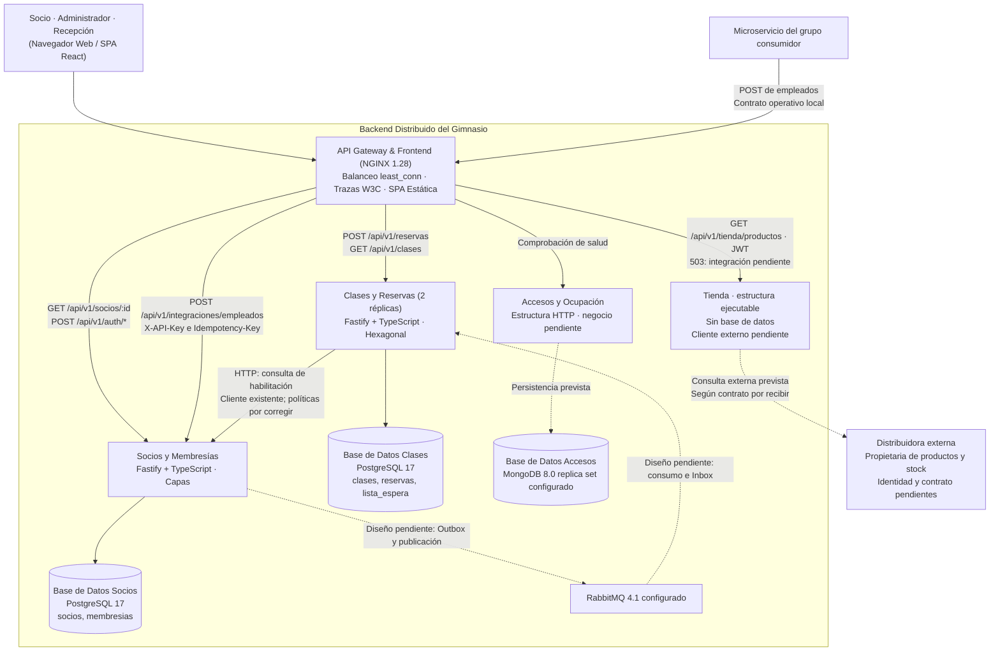

# Arquitectura del sistema - diseño de Entrega 1 y evolución

Este documento reúne el diseño de servicios requerido para la Entrega 1 y su evolución. La revisión del **19/10/2026** incluye las correcciones del flujo propio del paso 4 y el POST persistente de empleados publicado localmente por el gateway en el paso 5. La publicación accesible y prueba conjunta con el otro grupo siguen pendientes.

**Referencias del enunciado:** documentación de arquitectura en sección 3, página 4; integración entre grupos en sección 4.1, página 5; decisiones y conservación de su historia en sección 5, páginas 6–7. La Entrega 1 solicita el diseño inicial en sección 6.2, página 8.

## Integraciones acordadas - 19/10/2026

- **Capacidad ofrecida:** `POST /api/v1/integraciones/empleados`, a cargo de **Socios y Membresías**, según el [contrato de empleados](contracts/openapi-empleados-v1.yaml) y [ADR-014](adr/ADR-014-contrato-empleados.md). Reemplaza a la consulta de clases como capacidad ofrecida al otro grupo. El [contrato anterior](contracts/openapi-v1.yaml) y [ADR-008](adr/ADR-008-contrato-propio.md) quedan como antecedentes; las consultas de clases continúan como funcionalidad interna.
- El otro grupo envía `empleadoExternoId`, `dni`, `nombre` y `email`. La credencial `X-API-Key` identifica el origen autorizado; el origen no se toma de un campo enviado en el cuerpo.
- Una recepción válida crea un socio y una **solicitud de membresía `PENDIENTE`**, sin crear ni habilitar una membresía. El administrador elige el plan y confirma el pago antes de habilitarla. `PENDIENTE` es un estado de la solicitud, distinto del estado de una membresía.
- La repetición con el mismo origen, `Idempotency-Key` y cuerpo devuelve la respuesta original. Una clave reutilizada con otro cuerpo, un identificador externo asociado a otro DNI o un alta nueva con DNI/email ya existente devuelve `409`, sin modificar registros existentes.
- **Capacidad consumida:** el microservicio **Tienda** consultará productos y stock de una distribuidora, según [ADR-015](adr/ADR-015-limites-con-tienda.md). El catálogo y el stock pertenecen a la distribuidora. En el paso 6 se preparan servicio, gateway y pestaña del portal, sin base ni persistencia local. La consulta externa sigue pendiente: el equipo aún no dispone del contrato, URL ni autenticación.
- Los datos de prueba son ficticios. El **mock separado en memoria** se conserva para el contrato. En el paso 5, `empleados.http.ts` → `EmpleadosService` → `PostgresSociosRepository` implementan el alta atómica y el gateway publica su ruta. No se generan credenciales personales ni se habilita la membresía; su tratamiento administrativo y pago siguen pendientes.

## Microservicios y responsabilidades

### Estructura y controles implementados en el paso 4

- **Clases:** arquitectura Hexagonal. `app.ts` recibe HTTP; `application/reservas.service.ts` implementa casos de uso y depende de `ports.ts`; `repository.ts` y `clients/socios.client.ts` implementan los adaptadores. `server.ts` compone las dependencias y ejecuta el trabajador de promoción.
- **Socios:** arquitectura en Capas. `app.ts` → `AuthService`/`SociosService` en `services.ts` → `repository.ts`. Criptografía en `security.ts`, errores en `errors.ts` y entrada local administrativa en `crear-admin.ts`. Se conserva la decisión D2; detalle en [ADR-002](adr/ADR-002-arquitectura-interna-de-servicios.md).
- **Identidad:** JWT firmado, rol y propiedad en ambos servicios. Alta interna solo ADMIN, sin membresía automática; comando local para crear el administrador. Credencial `X-Service-Key` exclusiva de la consulta técnica de habilitación. [ADR-016](adr/ADR-016-autenticacion-y-altas.md).
- **Interfaz:** sesión en memoria, datos del perfil/clases/reservas desde sus APIs y errores visibles. Pagos, reactivación, comprobantes, QR y operaciones sin backend quedan identificadas como pendientes, sin simular resultados.
- **Consistencia:** escrituras atómicas por clase, sin validación HTTP dentro del bloqueo; cancelación local y promoción recuperable con prioridad FIFO. [D4 vigente, ADR-017](adr/ADR-017-consistencia-y-recuperacion-de-espera.md).

| Servicio | Responsabilidades de diseño | Estado de implementación |
|---|---|---|
| **Socios y Membresías** | Administrar socios, planes, membresías, pagos y comprobantes; evaluar habilitación; recibir empleados externos y gestionar sus solicitudes pendientes; comunicar cambios de membresía. | PostgreSQL, identidad, altas y consulta de habilitación. POST externo y almacenamiento de solicitudes/referencias/idempotencia operativos. Pagos, resolución administrativa de solicitudes y eventos pendientes. |
| **Clases y Reservas** | Publicar clases y horarios; gestionar reservas, cancelaciones y espera; controlar capacidad; ofrecer consultas internas de clases y cupos. | El código existente dispone de un adaptador PostgreSQL y rutas de clases/reservas. La publicación externa anterior se conserva como antecedente del contrato. |
| **Accesos y Ocupación** | Administrar sedes; registrar ingresos y egresos; validar membresía antes del ingreso; calcular ocupación a partir de presencias abiertas; gestionar caché de ocupación. | Estructura HTTP lista; soporte de MongoDB 8.0 replica set configurado. |
| **Tienda** | Consultar productos y stock de la distribuidora para la sección Tienda. La distribuidora conserva la propiedad del catálogo y sus existencias. | Workspace y Compose ejecutables, salud y ruta interna con JWT. Devuelve 503 INTEGRACION_PENDIENTE; no tiene cliente externo, catálogo de prueba ni base propia. |
| **API Gateway (NGINX)** | Enrutar peticiones entrantes, distribuir tráfico y propagar contexto de traza. | Puerto `8080` (o `GATEWAY_PORT`), `least_conn`, dos réplicas de Clases declaradas y ruta externa de empleados hacia Socios. |

## Propiedad de los datos y persistencia (D1, D3)

Los servicios que persisten datos utilizan almacenamiento propio e independiente. Ningún servicio accede directamente a las tablas de otro. Tienda consulta los datos de su proveedor y no incorpora almacenamiento local:

- **`Socios y Membresías` (PostgreSQL 17):** tablas `socios`, `membresias`, `solicitudes_membresia`, `empleados_externos` y `altas_empleados_idempotencia`.
- **`Clases y Reservas` (PostgreSQL 17):** tablas `clases`, `reservas` y `lista_espera`. Restricciones de unicidad parcial (`uq_reserva_activa`) para impedir duplicados y bloqueos de fila (`FOR UPDATE`) para proteger el aforo del último cupo.
- **`Accesos y Ocupación` (MongoDB 8.0 replica set):** almacenamiento previsto para sedes, movimientos e historial; el servicio todavía mantiene una estructura HTTP.
- **`Tienda` (sin base de datos):** consulta el catálogo y stock de la distribuidora; no administra existencias propias ni conserva una copia local. Los límites vigentes de los cuatro microservicios están en [ADR-015](adr/ADR-015-limites-con-tienda.md).

## Preparación de Tienda - paso 6

La pestaña Tienda del portal del socio usa la misma sesión JWT para llamar a `GET /api/v1/tienda/productos` por el gateway. Esta ruta pertenece al gimnasio; no define ninguna ruta de la distribuidora. En el estado actual devuelve `503 INTEGRACION_PENDIENTE`, sin artículos ni cantidades, y la pantalla distingue ese estado de un error de red o sesión.

La estructura en Capas es `services/tienda/src/app.ts` → `services.ts`, con composición en `server.ts`. `GET /health`, publicado como `/health/tienda`, confirma el proceso con `estado: estructura` e `integracion: PENDIENTE_CONTRATO`. No se configura URL externa, credencial de proveedor, base, caché, broker ni volumen. La implementación del cliente y de la respuesta de productos depende del contrato real; el detalle y la información faltante están en [D9](adr/ADR-009-consumo-del-proveedor.md). La integración externa no se acredita con esta estructura.

La recepción de empleados guarda socio, solicitud pendiente, referencia externa y resultado original en una transacción de la base `socios`. Los bloqueos por origen/clave y origen/empleado serializan los reintentos entre instancias; la unicidad de DNI/email impide conflictos con otras altas. No se crea una membresía y un error revierte toda el alta. El detalle está en [D3](adr/ADR-003-persistencia.md) y [D8](adr/ADR-014-contrato-empleados.md). El mock utiliza solo memoria. Tienda no cambia los motores existentes.

## Flujo de clases y reservas vigente - paso 4

Este flujo corresponde al dominio propio, comprobado con memoria y con PostgreSQL/HTTP real. No describe el nuevo contrato de empleados.

1. **Consulta interna de clases y cupos:**
   - El portal usa `GET /api/v1/reservas/clases` con Bearer JWT para obtener catálogo, reservas y espera propias. Los dos GET `/api/v1/clases` del contrato anterior se conservan con `X-API-Key`.
   - `Clases y Reservas` calcula dinámicamente en PostgreSQL `cuposDisponibles = capacidad - COUNT(reservas activas)`.
   - Responde con `Cache-Control: no-store` y cabeceras de traza W3C.
2. **Solicitud de reserva:**
   - El cliente envía `POST /api/v1/reservas` con `{ claseId }` y Bearer JWT. Se utiliza la identidad del token; solo ADMIN puede indicar otro `socioId`. La opción `ingresarEsperaSiLlena` es falsa salvo elección explícita.
   - Clases verifica la membresía en el instante actual y al inicio de la clase mediante dos GET a Socios en paralelo, con credencial técnica y propagación de traza. Sin cobertura en alguno de los dos momentos no se confirma.
   - Si la membresía está inactiva o vencida, retorna `422 MEMBRESIA_NO_HABILITADA`.
3. **Confirmación transaccional:**
   - Bajo una transacción PostgreSQL con `FOR UPDATE`, se verifica que el socio no tenga una reserva confirmada previa y que existan cupos libres.
   - Si hay cupo, se inserta la reserva con estado `CONFIRMADA` (HTTP 201).
   - Si la clase está llena, se ofrece ingreso voluntario a la lista de espera (HTTP 409 con opción de espera).
4. **Cancelación y promoción automática:**
   - Si un socio cancela antes del inicio (`POST /api/v1/reservas/:id/cancelar`), la cancelación se guarda localmente. Si hay espera, el cupo queda destinado al primero y la respuesta informa `reasignacionPendiente`.
   - El trabajador consulta la membresía fuera del bloqueo y luego verifica atómicamente prioridad, cupo, inicio y duplicados. Si Socios no responde, conserva al primero y reintenta. Si se comprueba una inhabilitación, lo retira y evalúa al siguiente. El trabajo pendiente se recupera a partir de las tablas existentes incluso con otra instancia.

**Límites:** pagos/renovación/reactivación, el evento de suspensión que cancela reservas futuras, la resolución administrativa de solicitudes y acceso personal de empleados, el dominio de Accesos y el cliente externo de Tienda siguen pendientes. La prueba SQL de dos instancias y la de balanceo son verificaciones funcionales; no acreditan capacidad máxima ni SLO.

## Balanceo y disponibilidad comprobada - paso 7

NGINX conserva `least_conn` y resolución DNS dinámica para las dos réplicas de Clases. El gateway registra `upstream_addr`, `upstream_status` y `upstream_response_time`; Clases responde con `X-Instance-ID` y Compose informa la salud de cada contenedor. Estos datos permiten verificar distribución y estado según §2.3, página 2, sin inferir todas las réplicas a partir de una única consulta `/health/clases`.

`npm run test:balanceo` construye una copia temporal del Compose con recursos propios y verifica distribución, último cupo, detención de una instancia, servicio estable desde la superviviente y reincorporación de un contenedor nuevo sin reiniciar NGINX. El reporte separa los errores durante la detección: en el cierre observado hubo cuatro HTTP 504 durante unos 3,3 s, seguidos de 40/40 lecturas correctas desde la superviviente; tras el reemplazo hubo 40/40 con distribución entre dos procesos.

La detección es pasiva por errores de upstream, complementada por DNS; las sondas de salud de Compose coordinan el inicio y exponen estado. No se configura una sonda activa HTTP de NGINX ni un despliegue redundante del gateway. Los parámetros, fuentes técnicas y límites están en [D12](adr/ADR-012-balanceo-de-carga.md); el reporte y la reproducción, en README. Esto no acredita un benchmark de carga ni disponibilidad de las bases compartidas.

## Trazabilidad distribuida y logs estructurados (D11)

- El código de Socios y Clases incorpora Pino y propagación de contexto mediante `tracing.ts`. La cobertura de campos y la validación entre procesos reales siguen pendientes de las correcciones de observabilidad.
- `scripts/demostrar-traza-distribuida.mjs` usa aplicaciones y repositorios en memoria. Esa demostración aislada no valida una ejecución distribuida con PostgreSQL ni demuestra el nuevo POST de empleados.

## Diagrama de contexto (C4 - Nivel 1)


## Diagrama de contenedores (C4 - Nivel 2)



Las líneas discontinuas señalan capacidades previstas. El diseño, workspaces y Compose contienen cuatro microservicios desde el paso 6. La respuesta de productos de Tienda y su llamada externa se definirán con el contrato de la distribuidora, sin asignar ahora rutas externas ni datos de conexión. Los patrones de Socios y Clases se concretaron en el paso 4; Tienda prepara una estructura en Capas, sin repositorio ni adaptador externo todavía.

## Diagrama de secuencia del flujo principal (Entrega 2)

```mermaid
sequenceDiagram
    autonumber
    actor Socio
    participant GW as API Gateway (NGINX)
    participant CR as Clases y Reservas
    participant SM as Socios y Membresías
    participant DB_SM as PostgreSQL (socios)
    participant DB_CR as PostgreSQL (clases)

    Socio->>GW: POST /api/v1/reservas { claseId }, Bearer JWT
    GW->>CR: Proxy + traceparent (00-traceId-spanId-01)
    CR->>CR: Verificar JWT y propietario
    CR->>DB_CR: SELECT clase (verificar existencia y que no haya iniciado)
    par Habilitación actual
        CR->>SM: GET habilitacion?fecha=ahora, X-Service-Key
    and Habilitación al inicio
        CR->>SM: GET habilitacion?fecha=inicio, X-Service-Key
    end
    SM->>DB_SM: SELECT socio + historial de membresías para cada fecha
    DB_SM-->>SM: Estado y períodos aplicables
    SM-->>CR: Ambas respuestas habilitadas (o error sin confirmar reserva)
    CR->>DB_CR: BEGIN; SELECT ... FROM clases FOR UPDATE
    CR->>DB_CR: Reverificar inicio, duplicados, aforo y prioridad de espera
    alt Hay cupo y no hay espera pendiente
        CR->>DB_CR: INSERT INTO reservas (CONFIRMADA); COMMIT
        CR-->>GW: 201 Created (Reserva confirmada + traceparent)
        GW-->>Socio: 201 Created
    else Sin cupo asignable respetando espera
        CR->>DB_CR: ROLLBACK
        CR-->>GW: 409 Conflict { codigo: CLASE_SIN_CUPOS, puedeIngresarEspera: true }
        GW-->>Socio: 409 Conflict (Ofrece lista de espera)
    end
```

## Registro de Decisiones Arquitectónicas (ADR)

| Decisión | Título | Estado | Documento |
|---|---|---|---|
| **D1 anterior** | Límites de los tres servicios originales | Reemplazado por ADR-015; conservado como antecedente | [ADR-001](adr/ADR-001-limites-de-servicios.md) |
| **D1 vigente** | Límites con Tienda como cuarto microservicio | Estructura propia preparada; consulta externa pendiente | [ADR-015](adr/ADR-015-limites-con-tienda.md) |
| **D2** | Arquitectura interna de los servicios | Hexagonal y Capas concretadas en Clases/Socios | [ADR-002](adr/ADR-002-arquitectura-interna-de-servicios.md) |
| **D3** | Persistencia relacional y documental | PostgreSQL propio y alta externa atómica verificados | [ADR-003](adr/ADR-003-persistencia.md) |
| **D4 anterior** | Consistencia y concurrencia | Reemplazada por ADR-017; antecedente | [ADR-004](adr/ADR-004-consistencia-y-concurrencia.md) |
| **D4 vigente** | Consistencia y recuperación FIFO | Cancelación local y promoción recuperable verificadas | [ADR-017](adr/ADR-017-consistencia-y-recuperacion-de-espera.md) |
| **D5** | Comunicación entre servicios (Síncrona y Asíncrona) | HTTP y POST externo operativos; mensajería pendiente | [ADR-005](adr/ADR-005-comunicacion-entre-servicios.md) |
| **D6** | Búsqueda | Catálogo filtrado; FTS preparado, consulta textual pendiente | [ADR-006](adr/ADR-006-busqueda.md) |
| **D7** | Caché | Diseño documentado; Redis pendiente | [ADR-007](adr/ADR-007-cache.md) |
| **D8** | Contrato de la capacidad propia anterior | Reemplazado para la publicación externa; antecedente de consultas de clases | [ADR-008](adr/ADR-008-contrato-propio.md) |
| **Actualización de D8** | Recepción de empleados y solicitud pendiente | Contrato 1.0.1, mock y POST persistente local verificados | [ADR-014](adr/ADR-014-contrato-empleados.md) |
| **D9** | Consumo del proveedor externo | Tienda responde integración pendiente; proveedor y contrato por recibir | [ADR-009](adr/ADR-009-consumo-del-proveedor.md) |
| **D10** | Resiliencia | Implementación parcial y pendientes identificados | [ADR-010](adr/ADR-010-resiliencia.md) |
| **D11** | Observabilidad (Logs, Trazas y Métricas) | 1ª versión en E2 | [ADR-011](adr/ADR-011-observabilidad.md) |
| **D12** | Balanceo de carga | Distribución, detección y reemplazo verificados con límites explícitos | [ADR-012](adr/ADR-012-balanceo-de-carga.md) |
| **D13** | Capacidad y estimación de costos | Línea base local y estimación ilustrativa | [ADR-013](adr/ADR-013-capacidad-y-costos.md) |
| Adicional | Autenticación y altas administradas | JWT, permisos y bootstrap local implementados | [ADR-016](adr/ADR-016-autenticacion-y-altas.md) |
